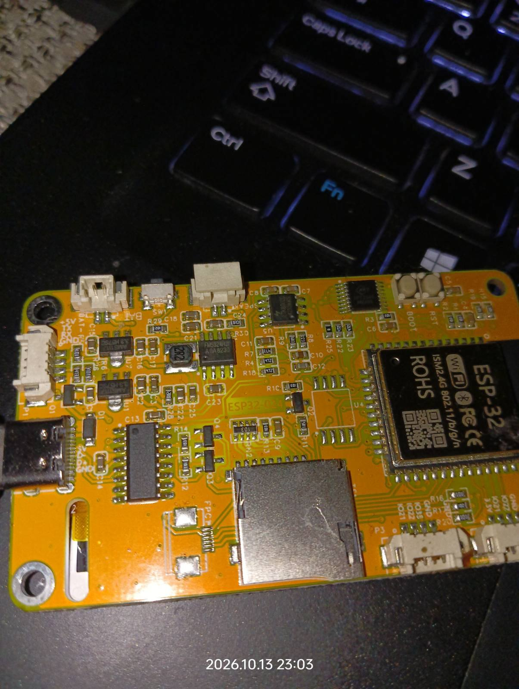

# ESP32-024 CRT Scope — retro phosphor oscilloscope for the CYD 2.4" boards

A green-phosphor, old-school CRT-style oscilloscope that runs on the **TZT L1435 2.4" / ESP32-024**
Cheap-Yellow-Display family boards (ESP32 + ST7789 240x320 + XPT2046 resistive touch, micro-USB + USB-C).

> **Came here from a search like “ESP32-024 XPT2046 touch not working”, “XPT2046 MISO always 0”
> or “CYD 2.4 touch dead on shared SPI”?** Skip straight to
> [The touch problem and the verified workaround](#-the-touch-problem-and-the-verified-workaround) —
> that is very likely your problem, and the fix is one line.

  

## Identify your board



The board this project was developed and verified on: **ESP32-024 / TZT L1435 2.4"** —
ESP32-WROOM-32 module, 2.4" 240x320 display (ST7789), resistive touch (XPT2046),
**both micro-USB (CH340, flashing) and USB-C (power-only on most units)**, microSD slot on the back edge.
Check the silkscreen marking on your PCB before flashing anything — the CYD family has many
siblings with different controllers and pin maps (see the
[witnessmenow CYD repo](https://github.com/witnessmenow/ESP32-Cheap-Yellow-Display) for the family tree).

Features: edge-triggered sweep, frequency + Vpp readout, decaying phosphor trail,
5 demo waveforms (when no probe signal is present), resistive **touch UI** with 3-point
calibration, persistent settings (NVS), BOOT-button fallback navigation.

## ⚠️ The touch problem and the verified workaround

On these boards the XPT2046 touchscreen shares the SPI bus with the display. During development
the touch appeared completely dead with the initially tested bus configuration, and came alive
after switching to a dedicated HSPI instance. The facts, separated from the theory:

**Observed on ESP32-024 / TZT L1435 2.4** (one unit tested so far):

* Touch reads failed with the tested VSPI configuration — the bus was the global `SPI` object
  (VSPI) with pins remapped to 14/12/13, driven by `TFT_eSPI`'s defaults. Every XPT2046 read
  returned 0 (or 0xFFF), with CS tried on fifteen different pins.
* Touch works with `SPIClass bus(HSPI); bus.begin(14, 12, 13, 15);` and the read sequence below.
* Keeping **LCD CS (15) and SD CS (5) HIGH during every touch transaction was also necessary**
  in the working configuration.
* HSPI on GPIO 12/13/14 is the **verified workaround for this setup**. Other board revisions
  and Arduino-ESP32 configurations may behave differently — if you can confirm or refute this
  on your unit, please open an issue.

Note: the switch to the working setup changed several things at once (SPI peripheral, display
driver, CS discipline, transaction sequence), so this project does **not** claim a specific
silicon mechanism — only the reproducible observation above. The classic CYD pinout
(CLK 25 / MOSI 32 / MISO 39) and I²C touch controllers (CST816/FT6336/GT911, incl. reset
sequencing) were also probed on this board and do not exist there.

Two more board-specific must-knows:

* **Hold SD_CS (GPIO 5) HIGH during every touch transaction.** The microSD socket shares the bus;
  a floating/low SD_CS can let the card controller fight the XPT2046 on MISO.
* **Colors**: the panel powers up color-inverted (ST7789 INVON at reset). `Adafruit_ST7789::init()`
  sends INVON and this sketch explicitly sends `tft.invertDisplay(false)` (INVOFF) — with that
  call present, **plain RGB565 colors display correctly**. Keep the call. (Porting to `TFT_eSPI`,
  which sends no inversion command by default? The panel stays inverted — either send INVON
  twice or software-negate every color.)

## How this was found (so you can recognise the same failure)

| Attempt | Result |
|---|---|
| XPT2046 on the TFT_eSPI bus (VSPI, matrix-routed), CS on 15 different pins | reads always 0 / 0xFFF |
| Classic CYD pinout (CLK 25 / MOSI 32 / MISO 39, CS 33) on a hardware HSPI + reference libraries | dead — that pinout does not exist on ESP32-024 |
| I²C touch (CST816/FT6336/GT911) scan over all GPIO pairs, incl. reset sequencing | no devices |
| PENIRQ (GPIO 36) reacting to touch while bus quiet | chip alive — the controller works |
| **Same pins, `SPIClass bus(HSPI)` + CS discipline (LCD/SD HIGH) + the sequence below** | **touch works instantly, stable coordinates** |

If your board shows the first row's symptom, the fix costs one line.

## ⚠️ Probe input safety

The scope input is **GPIO 34, 0–3.3 V only** (ADC, 11 dB attenuation).

* **GPIO34 is not a protected instrument input.** This is not a professional oscilloscope front-end.
* **Never connect it directly to mains (230 V/115 V), automotive wiring, or any other source of
  dangerous or unknown voltage** — doing so can destroy the board or cause injury.
* Signals outside 0–3.3 V (including 5 V logic and negative voltages) require a proper
  divider/attenuator front-end.

## The touch read sequence that works

```cpp
SPIClass bus(HSPI);                    // NOT the default VSPI!
// bus.begin(14, 12, 13, 15);          // SCLK, MISO, MOSI, SS

uint16_t read(uint8_t cmd) {
  digitalWrite(15, HIGH);              // LCD CS idle
  digitalWrite(5, HIGH);               // SD CS idle  <- critical
  bus.beginTransaction(SPISettings(2000000, MSBFIRST, SPI_MODE0));
  digitalWrite(33, LOW);               // touch CS
  bus.transfer(cmd);
  uint16_t v = bus.transfer16(0) >> 3; // 1 dummy bit + 12 data bits
  digitalWrite(33, HIGH);
  bus.endTransaction();
  return v;
}

// pressure = z1 + 4095 - z2   (commands 0xB1 / 0xC1; X = 0x91, Y = 0xD1)
// touched  = (pressure >= 400) || (digitalRead(36) == LOW)
```

## Verified configuration

Physically tested on the development board (see photo above):

| Function | Status |
|---|---|
| Display (ST7789, all rotations via setRotation) | ✅ verified |
| Colors (INVOFF + plain RGB565, phosphor palette) | ✅ verified |
| Touch: detection, pressure, coordinates | ✅ verified |
| 3-point calibration + NVS persistence | ✅ verified |
| Settings menu (touch) | ✅ verified |
| BOOT-button menu fallback | ✅ verified |
| ADC demo waveforms | ✅ verified |
| ADC probe input (GPIO 34) | implemented, not yet verified with an external signal |

Build used for verification: PlatformIO `espressif32` **7.1.3** (arduino-esp32 **2.0.17**),
Adafruit GFX **1.12.6**, Adafruit ST7735/ST7789 **1.11.0**, Adafruit BusIO **1.17.4**.

## Flashing

### Option A — prebuilt binary (no toolchain needed)

Grab `scope_full_4m.bin` from [Releases](../../releases) — a merged 4 MB image
(bootloader + partition table + firmware), built and verified on the ESP32-024.

* with esptool: `esptool --chip esp32 --port <PORT> --baud 921600 write_flash 0x0 scope_full_4m.bin`
* or drag & drop the same file in a Chromium browser at [web.esptool.io](https://web.esptool.io)
  (connect the micro-USB port, choose 4 MB flash size, offset 0x0)

### Option B — build from source

```bash
pio run -t upload          # PlatformIO, board: esp32dev
pio device monitor         # 115200 — raw touch events, telemetry
```

Dependencies (auto-installed): Adafruit GFX + Adafruit ST7735/ST7789.

## Using it

* **Scope mode**: green phosphor trace on a graticule, `ms/DIV` derived from the real sample rate,
  top bar shows volts/div + timebase, bottom bar shows input mode, frequency, Vpp and TRIG'D blink.
* **Probe**: connect a **0–3.3 V** signal to **GPIO 34** — the scope auto-switches from DEMO to
  probe mode (see the safety note above first!).
* **Touch anywhere** → settings window (timebase, phosphor persistence, demo waveform, grid).
  First use runs a 3-point calibration (touch the crosshairs); it is stored in NVS.
* **BOOT button** mirrors menu navigation (short = next row, long = change) as a fallback.

## Credits

* Touch sequence + ESP32-024 pin facts: [CheshirCa/CYD-Display-Library-for-PureBasic](https://github.com/CheshirCa/CYD-Display-Library-for-PureBasic)
* Variant documentation: [Keralots/BambuHelper](https://github.com/Keralots/BambuHelper),
  [witnessmenow/ESP32-Cheap-Yellow-Display](https://github.com/witnessmenow/ESP32-Cheap-Yellow-Display)

## License

MIT — see [LICENSE](LICENSE).
